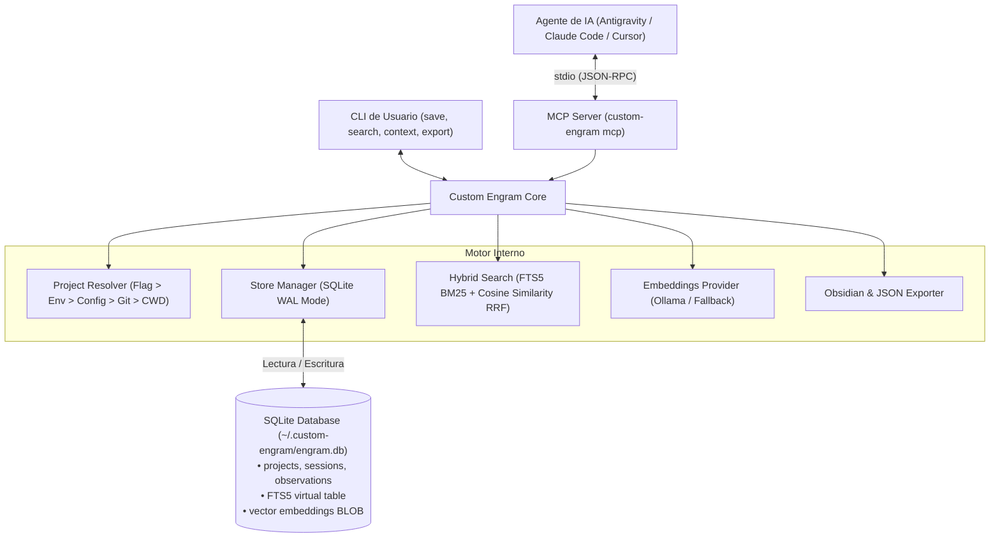

# Custom Engram

Sistema de memoria persistente para agentes de IA (Antigravity, Claude Code, Cursor, OpenCode, etc.), diseñado en Go con enfoque local-first, cero dependencias CGO y control total sobre el comportamiento y almacenamiento.

Inspirado en el diseño conceptual de [Gentleman-Programming/engram](https://github.com/Gentleman-Programming/engram), pero con optimizaciones clave:
1. **Zero-CGO en Windows**: Construido sobre `modernc.org/sqlite` con soporte FTS5 nativo, sin requerir GCC o MinGW.
2. **Búsqueda Híbrida Inteligente**: Combina búsqueda léxica FTS5 (BM25) con embeddings vectoriales locales (vía Ollama / API local) mediante Reciprocal Rank Fusion (RRF), con fallback automático a FTS5 si no hay embeddings disponibles.
3. **Resolución Determinista de Proyectos**: Evita errores por directorios ambiguos cuando se ejecuta en el directorio home (`$HOME`) o repositorios anidados.
4. **Servidor MCP Completo**: Expone el protocolo estándar Model Context Protocol (stdio) para integración directa con cualquier agente.
5. **Exportador Obsidian & JSON**: Generación automática de notas Markdown con frontmatter YAML y enlaces wiki `[[topic_key]]`.

---

## Arquitectura



---

## Compilación

```bash
# Compilar binario autónomo para Windows
go build -o bin/custom-engram.exe ./cmd/engram
```

---

## Configuración MCP para tus Agentes

Para conectar Custom Engram a tu agente de IA, añade la siguiente configuración a su archivo de configuración MCP (ej. `antigravity-cli`, Claude Desktop, OpenCode o Cursor):

```json
{
  "mcpServers": {
    "custom-engram": {
      "command": "C:\\Users\\Luis Mercury\\proyectos\\custom-engram\\bin\\custom-engram.exe",
      "args": ["mcp"]
    }
  }
}
```

### Herramientas MCP Disponibles

| Herramienta | Descripción |
|---|---|
| `mem_save` | Guarda una observación estructurada (decisión, bugfix, arquitectura, etc.) |
| `mem_update` | Actualiza campos puntuales de una memoria por su UUID exacto |
| `mem_search` | Búsqueda híbrida (FTS5 + embeddings) por palabras clave o significado |
| `mem_context` | Muestra el contexto reciente y últimas sesiones del proyecto |
| `mem_session_start` | Inicia una sesión de trabajo con un objetivo |
| `mem_session_end` | Finaliza la sesión actual con un resumen de lo logrado |
| `mem_session_summary` | Guarda un resumen completo de la sesión |
| `mem_suggest_topic_key` | Sugiere una clave estable normalizada (ej: `architecture/db-schema`) |
| `mem_capture_passive` | Extrae y guarda aprendizajes automáticamente de `## Key Learnings:` |
| `mem_pin` | Fija una memoria con prioridad alta para que aparezca arriba en el contexto |
| `mem_unpin` | Desfija una memoria para volver al orden cronológico |
| `mem_save_prompt` | Guarda el prompt del usuario en la base de datos |
| `mem_get_observation` | Recupera el contenido completo de una memoria por su ID |
| `mem_delete` | Elimina una memoria por su ID |
| `mem_current_project` | Detecta e informa el proyecto resuelto deterministamente |
| `mem_stats` | Estadísticas del sistema (memorias, sesiones, proyectos, prompts) |
| `mem_doctor` | Diagnóstico de salud de la base de datos y embeddings |
| `mem_judge` | Registra veredicto de relación entre memorias (compatible/supersedes) |
| `mem_compare` | Persiste veredicto semántico de comparación |
| `mem_archive` | Archiva o restaura una memoria puntual para ocultarla de búsquedas |
| `mem_prune` | Purga o archiva memorias antiguas con soporte de `--dry-run` |

---

## Uso desde Línea de Comandos (CLI)

### 1. Diagnóstico del Sistema
```bash
./bin/custom-engram.exe doctor
```

### 2. Inicializar un Proyecto
Crea un archivo `.engram/config.json` para fijar el nombre del proyecto:
```bash
./bin/custom-engram.exe init mi-proyecto
```

### 3. Guardar una Memoria
```bash
./bin/custom-engram.exe save "Arquitectura Go SQLite" "**What**: Usamos modernc.org/sqlite. **Why**: Cero CGO en Windows." --type architecture --topic-key "arch/storage"
```

### 4. Buscar Memorias
```bash
./bin/custom-engram.exe search "SQLite CGO"
```

### 5. Ver Contexto Reciente
```bash
./bin/custom-engram.exe context
```

### 6. Exportar a Obsidian o JSON
```bash
# Exportar a un vault de Obsidian con notas y enlaces vinculados
./bin/custom-engram.exe export --obsidian "C:/Ruta/A/MiVault"

# Exportar respaldo en JSON
./bin/custom-engram.exe export --json "C:/Ruta/backup.json"
```

### 7. Limpieza y Mantenimiento Seguro (Prune y Archivo)
Custom Engram implementa una estrategia de ciclo de vida con **TTL Semántico y Soft-Delete** para evitar pérdida de datos:
- Las memorias fijadas (`is_pinned = 1`) y las de tipo `architecture` y `decision` están **protegidas por defecto**.
- Por defecto se archivan (*soft-delete*), quedando fuera del contexto y búsquedas del agente, pero preservadas para consulta o auditoría.

```bash
# Simular limpieza de memorias viejas sin modificar la base de datos (Dry-Run):
./bin/custom-engram.exe prune --older-than 90d --dry-run

# Ejecutar archivado de memorias con más de 90 días de inactividad:
./bin/custom-engram.exe prune --older-than 90d

# Listar memorias archivadas:
./bin/custom-engram.exe archive --list

# Archivar o restaurar manualmente por ID:
./bin/custom-engram.exe archive <observation-id>
./bin/custom-engram.exe archive <observation-id> --unarchive
```

---

## Variables de Entorno Opcionales

- `ENGRAM_DATA_DIR`: Directorio de almacenamiento de la base de datos (por defecto `~/.custom-engram`).
- `ENGRAM_PROJECT`: Fuerza el nombre del proyecto activo independientemente del directorio actual.
- `OLLAMA_HOST`: URL del servidor Ollama (por defecto `http://localhost:11434`).
- `ENGRAM_EMBED_MODEL`: Modelo de embeddings de Ollama a utilizar (por defecto `nomic-embed-text`).
